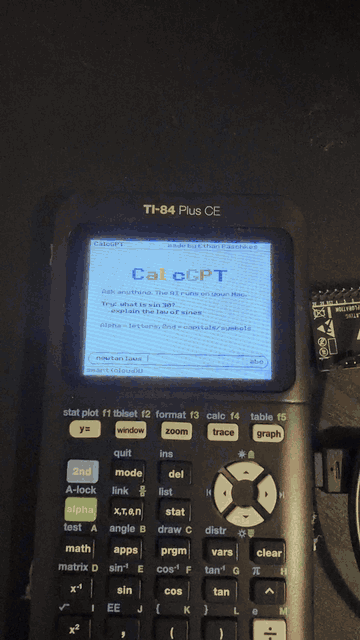
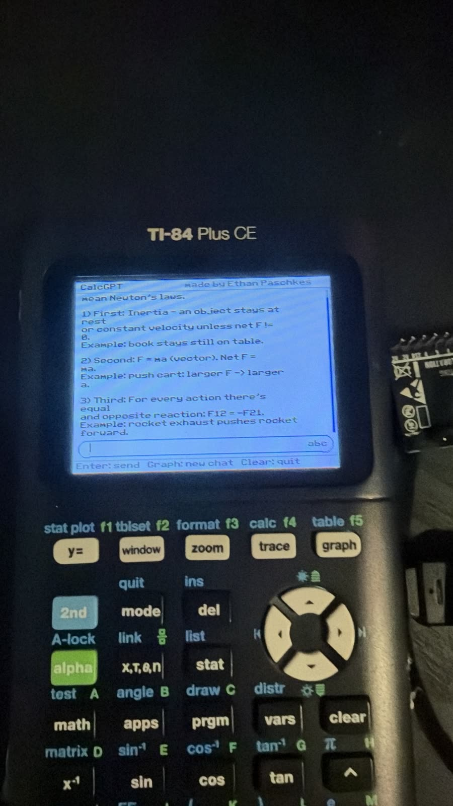
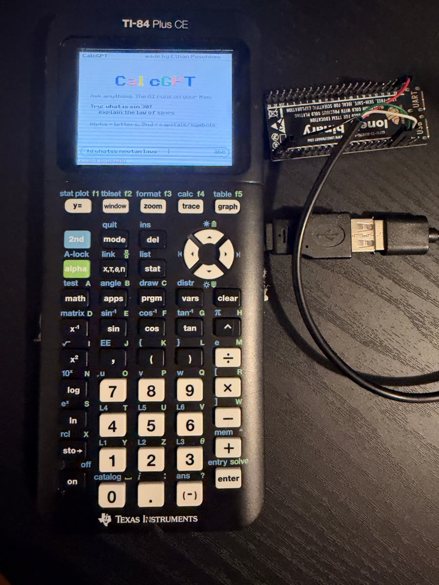

# CalcGPT for the TI-84 Plus CE: ChatGPT, Wi-Fi and more on a graphing calculator

**Ask ChatGPT questions on a TI-84 Plus CE and watch the answer stream onto the calculator screen, over a cable or wirelessly
through a small ESP32-S3 board.** This repository also has a Desmos-style equation solver, a text web browser, a video and
screen-share player, and a home-screen shell, all written in C for the TI-84 Plus CE.

<p align="center">
  
</p>


> **Download:** ready-to-send `.8xp` programs are on the [Releases page](../../releases). Send them with TI Connect CE.

## What's inside

| Folder | What it is | Status |
|---|---|---|
| [`calcgpt/`](calcgpt/) | **CalcGPT**: a general AI chat on the calculator. Type a question, the answer streams in. **Trace** picks the model: OpenAI cloud models (GPT-5 mini, GPT-5 with web search, GPT-5.5) or a private local model on your Mac through [Ollama](https://ollama.com). | Works on a real calculator, cabled and wireless |
| [`wireless/`](wireless/) | **Wireless link**: an ESP32-S3 board plugged into the calculator joins Wi-Fi and stands in for the USB cable. The calculator even powers the board. Every Mac program here works through it unchanged. | Works with a real calculator ([setup guide](wireless/ESP_SETUP.md)) |
| [`solver/`](solver/) | **SOLVER**: a Desmos-style notebook for trig and algebra. Type an equation and get exact and decimal answers, triangle solving, and guided forms. | Solving tested on a calculator |
| [`browser/`](browser/) | **CalcSearch**: a text web browser. The Mac fetches and cleans up pages; the calculator shows search results and pages. | Tested on a computer |
| [`reels/`](reels/) | **Reels**: video clips and live screen sharing from the Mac on the calculator screen, with optional mouse and keyboard control of the Mac from the calculator. | Works on a real calculator |
| [`calcos/`](calcos/) | **CalcOS**: a home-screen shell with app tiles, a clock, a stopwatch, notes and system info, on top of TI-OS. | Tested on a computer |
| [`usbtest/`](usbtest/) | Measures the USB link speed (about 180 KB/s) and checks key presses. Start here if something doesn't connect. | Works on a real calculator |
| [`experiments/`](experiments/) | Earlier experiments: physics simulations (orbits, pendulum, gas box, Maxwell distribution and more), an offline ELIZA-style chat, TrigGPT, a grapher, a trig tool, and a photo-equation demo. | Mixed |

|  |  |
|---|---|
| A CalcGPT answer, streamed over Wi-Fi | The wireless setup: the calculator powers the ESP32-S3 board |

## How it works

```
                 USB cable (or the ESP32-S3 board over Wi-Fi)
TI-84 Plus CE  <---------------------------------------------->  Mac
 C program                                                        Python program
 (draws, reads keys)                                              (talks to ChatGPT / Ollama, fetches pages, encodes video)
```

The calculator's mini-USB port shows up on the Mac as a plain USB serial port, using the CE toolchain's `srldrvce` library. No
extra hardware is needed for the cabled version. The heavy work runs on the Mac, and the calculator draws and handles keys, so a
48 MHz eZ80 can stream a GPT answer word by word.

For the wireless version, an ESP32-S3 board plugs into the calculator through a USB OTG adapter, joins Wi-Fi, logs in to
`wireless/calcnet.py` on the Mac with a challenge-and-response secret, and passes the bytes both ways. The calculator powers the
board, so there is no battery or charger to carry.

## Quick start (cabled)

1. Get the programs: download them from [Releases](../../releases), or build them yourself with the
   [CE C/C++ toolchain](https://ce-programming.github.io/toolchain/) (`make` in a program's folder; the result is in `bin/`).
2. Send the program and the [CE C libraries](https://github.com/CE-Programming/libraries/releases) (`clibs.8xg`) to the
   calculator with TI Connect CE.
3. **On TI-OS 5.5 or newer**, C programs need a jailbreak to run; see [arTIfiCE](https://yvantt.github.io/arTIfiCE/).
4. CalcGPT on the Mac:
   ```
   cd calcgpt/mac
   cp .env.example .env              # put your OpenAI key in .env (never share or commit it)
   python3 calcgptd.py               # then start CALCGPT on the calculator
   ```
   Edit `calcgpt/mac/models.json` to choose the models on the Trace menu.

## Quick start (wireless)

See **[wireless/ESP_SETUP.md](wireless/ESP_SETUP.md)** for the parts list (about $25-35: an ESP32-S3 dev board, a USB-A-to-jumper-wire
cable and a USB OTG adapter), the wiring, and how to load the firmware.

## Tests

Most of the logic is written so it can run on a computer, with no calculator needed:

```
python3 calcgpt/mac/test_calcgptd.py      # CalcGPT's Mac side, with a fake model
python3 calcgpt/tests/test_calcgpt.py     # CalcGPT's calculator-side chat code, compiled for the Mac (needs clang)
python3 wireless/test_calcnet.py          # the wireless login and serial link
python3 browser/mac/test_browserd.py      # the browser's Mac side, no internet needed
python3 reels/tests/test_viewer.py        # the calculator's picture decoder, pixel by pixel
python3 calcos/tests/test_calcos.py       # the CalcOS logic
```

## Safety and privacy

- **Cloud models** send your questions to OpenAI and cost money per answer. A **local model** (Ollama) keeps everything on your Mac.
- **Keep your keys secret.** `.env` and the board's `secrets.h` (Wi-Fi password and link secret) are ignored by git. Only the
  `.example` versions are in this repository.
- The wireless link checks a secret at login, but the data after that is not encrypted. Use it on a network you trust.
- Screen sharing and Mac control (`reels`) are off unless you turn them on, and they need macOS permissions you grant yourself.
- **Use CalcGPT honestly.** Keep it out of tests and anywhere your teacher hasn't allowed it.

## FAQ

**Does it work on a TI-84 Plus (not CE), TI-83 Premium CE or TI-Nspire?** It's built for the TI-84 Plus CE. The TI-83 Premium CE
uses the same hardware and should work. The older monochrome TI-84 Plus and the Nspire will not.

**Do I need the ESP32?** No. With the normal USB cable to a Mac, everything works. The ESP32 is only for going wireless.

**Can it run without a computer?** Not yet: the Mac does the AI calls. Running the AI calls on the ESP32 itself is a possible next step.

---

Made by [Ethan Paschkes](https://ethanpaschkes.com), student developer and glider pilot.
If you build one, open an issue or a discussion: I'd love to see it.

Keywords: TI-84 Plus CE ChatGPT, TI-84 AI, calculator ChatGPT, ESP32 TI-84, TI-84 wifi, CE C toolchain, srldrvce, usbdrvce, cemetech.
